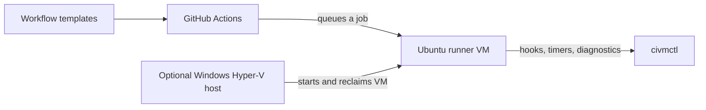

<p align="center">
  <a href="README.md"><b>English</b></a> •
  <a href="README.pt-BR.md">Português (Brasil)</a>
</p>

# civm

[](https://github.com/emersonbusson/civm/actions/workflows/ci.yml)
[](LICENSE)

**civm** is open-source tooling to **provision and operate self-hosted
GitHub Actions runners** on a Linux VM (with optional Windows Hyper-V host
helpers). It provides the operational pieces around a runner: provisioning,
health checks, safe cleanup, queue hygiene, and reusable workflow templates.

**English is the canonical documentation language.** The [Português (Brasil)
README](README.pt-BR.md) is the secondary translation and may lag behind the
English version. See [Contributing](CONTRIBUTING.md) for the language policy.

## Start here

- **Operate a Linux runner:** [multi-project runner guide (PT-BR)](runbooks/MULTI-PROJECT-RUNNER.md)
- **Browse the documentation:** [documentation index](docs/README.md)
- **Adopt workflow templates:** [`templates/`](templates/)
- **Contribute:** [CONTRIBUTING.md](CONTRIBUTING.md)
- **Report a security issue:** [SECURITY.md](SECURITY.md)

## What civm provides

- `civmctl`, a Go CLI for provisioning and maintaining the Linux runner guest.
- Managed runner hooks, systemd timers, health and capacity diagnostics, and queue cleanup.
- Copyable GitHub Actions workflow templates for repositories that use the runner.
- Optional Windows Hyper-V host helpers for waking and reclaiming a dedicated VM.

GitHub Actions remains the scheduler. civm is not a hosted CI service or a
multi-tenant fleet: operators choose which repositories a runner serves.

## Operational model



The runner executes repository workflow code on operator-managed hardware.
Choose which repositories can use it with that trust boundary in mind. The
external JIT dispatcher remains **NO-GO**: no approved isolation driver is
available. See its [runbook (PT-BR)](runbooks/TRUSTED-JIT-DISPATCHER.md).

## Windows Hyper-V host (optional scale-to-zero)

Production host brain today: PowerShell under `deploy/windows/`. Control-plane
tasks run as **SYSTEM**, while `civm-gate` runners use
`NETWORK SERVICE/ServiceAccount/Limited` with protected least-privilege ACLs.
Configure **`Repos`** and **`TokenPaths`** on the host (empty in-repo defaults by design).
Prefer a **host-local lab wrapper** so organization and repository fleet details never land in git.

- Runbook (PT-BR): [`runbooks/HOST-ORCHESTRATOR-SETUP.md`](runbooks/HOST-ORCHESTRATOR-SETUP.md)
- Behavior: [`docs/specs/orchestrator-scale-to-zero/`](docs/specs/orchestrator-scale-to-zero/)
- Optional C# port (shadow until cutover): sibling project **civm-host**

## Runner setup

The detailed provisioning and migration procedures are in the
[multi-project runner guide (PT-BR)](runbooks/MULTI-PROJECT-RUNNER.md). The
English version is not available yet; use the documentation index to find the
available language for each operational guide.

Register a runner (tokens are ephemeral and must never be committed):

```bash
TOKEN=$(gh api -X POST /repos/<owner>/<repo>/actions/runners/registration-token --jq .token)
civmctl runner add --repo=<owner>/<repo> --token="$TOKEN" --short=<short> --execute
```

Prefer **one organization-level runner** when many repositories share a box (to ensure clean job serialization).
See the PT-BR guides [`runbooks/RUNNER-SERIALIZATION.md`](runbooks/RUNNER-SERIALIZATION.md) and [`runbooks/ORG-RUNNER-ADOPTION.md`](runbooks/ORG-RUNNER-ADOPTION.md).

Full multi-runner / disk / host operations guide (PT-BR): [`runbooks/MULTI-PROJECT-RUNNER.md`](runbooks/MULTI-PROJECT-RUNNER.md).

## civmctl Commands

| Command | Description |
|---|---|
| `civmctl version-pins` | Prints target tool versions (parity with `ubuntu-latest`) |
| `civmctl parity [--json]` | Validates installed tools on the VM against authoritative pins |
| `civmctl bootstrap [--execute]` | Provisions the Ubuntu 24.04 VM (default: dry-run) |
| `civmctl cleanup [--execute] [--managed-volumes]` | Cleans Docker, `/tmp`, old `_work` artifacts, and apt cache; preserves `_work/_tool` and `_work/_actions`; `--managed-volumes` removes classified Compose volumes; aborts if active job/build detected |
| `civmctl health` | System health check (disk, memory, runners, and last cleanup status) |
| `civmctl doctor [--repos=auto|owner/repo,...|none] [--json]` | Read-only consolidated diagnosis: host, hooks, systemd runner units, and GitHub Actions API |
| `civmctl idle-check [--json]` | Read-only idleness detector: exits `0=idle`, `1=busy`, `2=unknown` |
| `civmctl hook install [--execute] [--runner-glob=...]` | Reconciles and installs `ACTIONS_RUNNER_HOOK_*` scripts and runner `.env` |
| `civmctl runner add` | Registers and starts a self-hosted GitHub Actions runner in one command |
| `civmctl runner remove` | Safely unregisters and removes a runner (fail-closed if stop/uninstall fails) |
| `civmctl drift` | Compares local tool pins with upstream GitHub `actions/runner-images` via HTTP |
| `civmctl billing-status` | Heuristic detector for billing blocks (zero extra PAT required) |
| `civmctl peer-status` | Read-only status of adoption, health, and billing across repositories |
| `civmctl active-runs [--repos=auto|owner/a,owner/b] [--include-eta] [--json]` | Lists running and queued workflows with historical ETA |
| `civmctl reap-runs --repos=owner/a[,owner/b] [--execute]` | Cancels closed PR runs (`pr-not-open`) and superseded SHA runs (`superseded-sha`) to keep queues healthy |
| `civmctl actions-metrics --org=ORG [--period=month|week|day] [--json]` | Aggregates billable minutes and execution counts across repositories |
| `civmctl runner list` | Lists systemd runner services on the VM |
| `civmctl runner restart` | Restarts runner services and verifies active state after delay |
| `civmctl runner upgrade` | Performs in-place binary runner upgrades without losing configuration |
| `civmctl runner watchdog [--execute] [--repos=auto]` | Self-heals hooks/runners and recovers stalled runner sessions |
| `civmctl reverse-watchdog` | Alerts if the disk watchdog timer fails to fire within the expected window |
| `civmctl capacity [--json]` | Read-only capacity status: disk, active workers, and job acceptance |
| `civmctl metrics dump` | Exports Prometheus textfile metrics for `node_exporter` scraping |
| `civmctl bootstrap-everything` | Full bootstrap wrapper: copies systemd units, reloads daemon, and executes bootstrap |
| `civmctl disk-watchdog` | Triggers emergency cleanup when disk usage exceeds threshold (default 60%) |
| `civmctl disk-audit [--json]` | Read-only audit of major disk space owners (`_work`, caches, Docker, logs) |
| `civmctl jit-dispatch` | Experimental one-shot dispatcher; activation remains **NO-GO** until an approved isolation driver exists |

### Trusted JIT Pilot

The external dispatcher code requires HTTP 200 with an explicit `workflow_run_id`, accepts tokens only through stdin, and generates single-use 256-bit nonce labels. Activation remains **NO-GO** because no approved isolation driver is available. See the [JIT runbook (PT-BR)](runbooks/TRUSTED-JIT-DISPATCHER.md).

### Add Runner for a New Repository (1 Command)

```bash
TOKEN=$(gh api -X POST /repos/<owner>/<repo>/actions/runners/registration-token --jq .token)

# Dry-run first:
civmctl runner add --repo=<owner>/<repo> --token=$TOKEN --short=<short>

# Apply:
civmctl runner add --repo=<owner>/<repo> --token=$TOKEN --short=<short> --execute
```

## Structure by Audience

### Maintainers of this Repository

| File | Role |
|---|---|
| `README.md` / `README.pt-BR.md` | English canonical overview / secondary PT-BR translation |
| `LICENSE` / `CONTRIBUTING.md` / `SECURITY.md` | Open-source baseline and governance |
| `.github/workflows/ci.yml` | GitHub-hosted CI (`ubuntu-latest` and `windows-latest`) |
| `.gitignore` | Prevents secrets and lab logs from entering git |

### VM Administrators (Sysadmins)

| File | Role |
|---|---|
| `runbooks/MULTI-PROJECT-RUNNER.md` | Complete guide to provision VMs, runners, and systemd timers |
| `runbooks/RUNNER-SERIALIZATION.md` | Job serialization invariants and concurrency protection |
| `runbooks/RUNBOOK-HOST-VHDX-MAINTENANCE.md` | Host VHDX maintenance and disk space reclamation |
| `runbooks/LOCAL-CI-DISCIPLINE.md` | Philosophy of local validation gates and remote mirroring |

### Consumer Projects (Peer Repositories) — Copyable Templates

| File | How to Adopt |
|---|---|
| `templates/ci-optimistic.yml.template` | Copy to `.github/workflows/ci.yml` in your repo |
| `templates/ci-router.yml.template` | Tier 1 router with automatic routing between GitHub-hosted and self-hosted CI |
| `templates/cancel-on-pr-close.yml.template` | Automatically cancels runs when a PR is closed |
| `templates/cancel-stale-on-push.yml.template` | Automatically cancels stale runs when new commits are pushed |
| `templates/CIVM-USAGE.md` | Operational guide to copy to `docs/CIVM.md` in your repo |
| `templates/COMMUNICATION-STYLE.md` | Concise technical communication guidelines |

## How civm Works

1. **One-Time Setup** via the [multi-project runner guide (PT-BR)](runbooks/MULTI-PROJECT-RUNNER.md):
   - Provision Linux VM (Ubuntu 24.04 LTS, 12 vCPUs, 12 GiB RAM, dedicated SSD).
   - Install toolchains (Go, Node, Docker, gh CLI) with `ubuntu-latest` parity.
   - Register runners with the `civm` label.
   - Enable systemd timers for cleanup, disk watchdog, runner watchdog, and metrics.

2. **Scale-to-Zero on Host**: The VM does not sit idle consuming host resources. The host orchestrator boots the VM on demand when jobs are queued, and shuts it down after completion and disk optimization.

3. **Workflow Execution**: Consumer repositories declare `runs-on: [self-hosted, civm]` in their workflow files.

4. **Optional routing template**: `templates/ci-router.yml.template` uses the billing-status heuristic to choose a runner for project jobs; when the result is unknown, it defaults to GitHub-hosted.

## Versioning and Releases

`civm` follows SemVer (MAJOR.MINOR.PATCH). Tags and GitHub Releases are generated automatically via `release-please` from Conventional Commits on `main`:

- `fix:` → bumps PATCH (`v1.0.0` → `v1.0.1`).
- `feat:` → bumps MINOR (`v1.0.0` → `v1.1.0`).
- `feat!:` or `BREAKING CHANGE:` → bumps MAJOR (`v1.0.0` → `v2.0.0`).
- `docs:`, `chore:`, `test:`, `build:` → do not bump versions.

Workflow [`.github/workflows/release.yml`](.github/workflows/release.yml) maintains the release PR. Merging that PR creates the release tag and publishes the release notes automatically. See [`runbooks/RELEASE-AUTOMATION.md`](runbooks/RELEASE-AUTOMATION.md).

## License

[MIT](LICENSE) — see [CONTRIBUTING.md](CONTRIBUTING.md) and [SECURITY.md](SECURITY.md).
