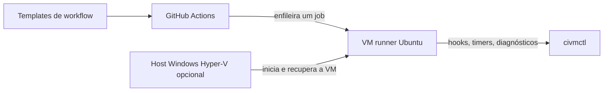

<p align="center">
  <a href="README.md">English</a> •
  <a href="README.pt-BR.md"><b>Português (Brasil)</b></a>
</p>

# civm

[](https://github.com/emersonbusson/civm/actions/workflows/ci.yml)
[](LICENSE)

**civm** é um conjunto de ferramentas open-source para **provisionar e operar runners self-hosted do GitHub Actions** em uma VM Linux (com helpers opcionais para Windows Hyper-V). Ele oferece as peças operacionais ao redor do runner: provisionamento, verificações de saúde, limpeza segura, higiene da fila e templates reutilizáveis de workflow.

**O inglês é o idioma canônico da documentação.** Este README em português é a tradução secundária e pode ficar defasado em relação à versão em inglês. Consulte [CONTRIBUTING.md](CONTRIBUTING.md) para a política de idiomas.

## Por onde começar

- **Operar um runner Linux:** [guia de runner multi-projeto](runbooks/MULTI-PROJECT-RUNNER.md)
- **Ver a documentação:** [índice de documentação](docs/README.pt-BR.md)
- **Adotar templates de workflow:** [`templates/`](templates/)
- **Contribuir:** [CONTRIBUTING.md](CONTRIBUTING.md)
- **Reportar um problema de segurança:** [SECURITY.md](SECURITY.md)

## O que o civm oferece

- `civmctl`, CLI em Go para provisionar e manter o guest Linux do runner.
- Hooks gerenciados, timers systemd, diagnósticos de saúde/capacidade e limpeza da fila.
- Templates copiáveis do GitHub Actions para repositórios que usam o runner.
- Helpers opcionais para o host Windows Hyper-V iniciar e recuperar uma VM dedicada.

O GitHub Actions continua sendo o agendador. O civm não é um serviço de CI
hospedado nem uma frota multi-tenant: operadores escolhem quais repositórios
um runner atende.

## Modelo operacional



O runner executa código dos workflows em hardware administrado por quem opera
a máquina. Considere essa fronteira de confiança ao escolher quais repositórios
podem usá-lo. O dispatcher JIT externo permanece em **NO-GO**: não há driver
de isolamento aprovado. Consulte o [runbook JIT (PT-BR)](runbooks/TRUSTED-JIT-DISPATCHER.md).

## Host Windows Hyper-V (Scale-to-Zero Opcional)

A automação de produção do host Windows reside em PowerShell sob `deploy/windows/`. As tarefas do control-plane executam como **SYSTEM**, enquanto os runners `civm-gate` executam como `NETWORK SERVICE/ServiceAccount/Limited` sob privilégios mínimos protegidos.

Configure as listas de **`Repos`** e **`TokenPaths`** no host (mantidos vazios no repositório por design de segurança). Recomenda-se um wrapper local no laboratório para que detalhes da frota nunca sejam commitados no Git.

- Runbook (PT-BR): [`runbooks/HOST-ORCHESTRATOR-SETUP.md`](runbooks/HOST-ORCHESTRATOR-SETUP.md)
- Especificação de comportamento: [`docs/specs/orchestrator-scale-to-zero/`](docs/specs/orchestrator-scale-to-zero/)
- Port opcional em C# (shadow): projeto irmão **civm-host**

## Configuração do runner

Os procedimentos detalhados de provisionamento e migração estão no
[guia de runner multi-projeto](runbooks/MULTI-PROJECT-RUNNER.md). Consulte o
índice de documentação para identificar o idioma disponível em cada guia.

Registrar um novo runner (o token é efêmero e nunca deve ser commitado):

```bash
TOKEN=$(gh api -X POST /repos/<owner>/<repo>/actions/runners/registration-token --jq .token)
civmctl runner add --repo=<owner>/<repo> --token="$TOKEN" --short=<short> --execute
```

Recomenda-se utilizar **um único runner em nível de organização** quando vários repositórios compartilham a mesma máquina (para garantir serialização limpa de jobs). Consulte os guias PT-BR [`runbooks/RUNNER-SERIALIZATION.md`](runbooks/RUNNER-SERIALIZATION.md) e [`runbooks/ORG-RUNNER-ADOPTION.md`](runbooks/ORG-RUNNER-ADOPTION.md).

Guia de operação multi-runner, disco e host (PT-BR): [`runbooks/MULTI-PROJECT-RUNNER.md`](runbooks/MULTI-PROJECT-RUNNER.md).

## Comandos do civmctl

| Comando | Função |
|---|---|
| `civmctl version-pins` | Imprime as versões alvo de ferramentas (paridade com `ubuntu-latest`) |
| `civmctl parity [--json]` | Valida ferramentas instaladas na VM contra os pins autoritativos |
| `civmctl bootstrap [--execute]` | Provisiona a VM Ubuntu 24.04 (padrão: dry-run) |
| `civmctl cleanup [--execute] [--managed-volumes]` | Limpa Docker, `/tmp`, artefatos antigos de `_work` e apt cache; preserva `_work/_tool` e `_work/_actions`; `--managed-volumes` remove volumes Compose classificados; aborta se houver job/build ativo |
| `civmctl health` | Relatório de integridade do sistema (disco, memória, runners e último cleanup) |
| `civmctl doctor [--repos=auto|owner/repo,...|none] [--json]` | Diagnóstico consolidado read-only: host, hooks, units systemd e GitHub Actions API |
| `civmctl idle-check [--json]` | Detector read-only de ociosidade: retorna código de saída `0=idle`, `1=busy`, `2=unknown` |
| `civmctl hook install [--execute] [--runner-glob=...]` | Reconcilia e instala scripts `ACTIONS_RUNNER_HOOK_*` e `.env` dos runners |
| `civmctl runner add` | Registra e inicia um runner GitHub Actions self-hosted em 1 comando |
| `civmctl runner remove` | Remove e desregistra um runner de forma segura (com fail-closed se stop/uninstall falhar) |
| `civmctl drift` | Compara pins locais com a imagem upstream do GitHub `actions/runner-images` via HTTP |
| `civmctl billing-status` | Detector heurístico de bloqueio de billing (requer apenas permissões básicas de token) |
| `civmctl peer-status` | Observabilidade read-only da saúde e consumo de billing de múltiplos repositórios |
| `civmctl active-runs [--repos=auto|owner/a,owner/b] [--include-eta] [--json]` | Lista workflow runs em andamento e em fila com estimativa de tempo restante (ETA) |
| `civmctl reap-runs --repos=owner/a[,owner/b] [--execute]` | Cancela runs de PRs já fechados (`pr-not-open`) e SHAs supersedidos (`superseded-sha`) para manter a fila limpa |
| `civmctl actions-metrics --org=ORG [--period=month|week|day] [--json]` | Agrega minutos faturáveis e execuções cross-repo |
| `civmctl runner list` | Lista runners systemd instalados na VM |
| `civmctl runner restart` | Reinicia services de runner com verificação de status |
| `civmctl runner upgrade` | Atualiza o binário do runner in-place sem perder configurações |
| `civmctl runner watchdog [--execute] [--repos=auto]` | Repara hooks/runners e recupera sessões travadas |
| `civmctl reverse-watchdog` | Alerta caso o timer de watchdog de disco não dispare no tempo esperado |
| `civmctl capacity [--json]` | Relatório estável de capacidade: disco, workers ativos e aceitação de jobs |
| `civmctl metrics dump` | Exporta métricas em formato Prometheus para coleta por `node_exporter` |
| `civmctl bootstrap-everything` | Wrapper completo: cópia de units systemd + reload + bootstrap |
| `civmctl disk-watchdog` | Dispara limpeza emergencial se o uso de disco ultrapassar o limite (padrão 60%) |
| `civmctl disk-audit [--json]` | Auditoria read-only dos maiores consumidores de disco (`_work`, caches, Docker, logs) |
| `civmctl jit-dispatch` | Dispatcher experimental one-shot; ativação permanece em **NO-GO** até existir driver de isolamento aprovado |

### Piloto JIT Confiável

O dispatcher externo exige um `workflow_run_id` explícito, recebe tokens via stdin e gera labels nonce de uso único (256 bits). A ativação permanece em **NO-GO** porque não há driver de isolamento aprovado. Consulte o [runbook JIT (PT-BR)](runbooks/TRUSTED-JIT-DISPATCHER.md).

### Adicionar Runner para Novo Repositório (1 Comando)

```bash
TOKEN=$(gh api -X POST /repos/<owner>/<repo>/actions/runners/registration-token --jq .token)

# Testar com dry-run primeiro:
civmctl runner add --repo=<owner>/<repo> --token=$TOKEN --short=<short>

# Executar a instalação:
civmctl runner add --repo=<owner>/<repo> --token=$TOKEN --short=<short> --execute
```

## Estrutura por Audiência

### Mantenedores deste Repositório

| Arquivo | Função |
|---|---|
| `README.md` / `README.pt-BR.md` | Visão canônica em inglês / tradução secundária PT-BR |
| `LICENSE` / `CONTRIBUTING.md` / `SECURITY.md` | Diretrizes open-source e governança |
| `.github/workflows/ci.yml` | CI do repositório em runners GitHub-hosted gratuitos |
| `.gitignore` | Proteção contra commits de segredos ou logs de lab |

### Administradores da VM (Sysadmins)

| Arquivo | Função |
|---|---|
| `runbooks/MULTI-PROJECT-RUNNER.md` | Guia completo de provisionamento de VM, runners e timers systemd |
| `runbooks/RUNNER-SERIALIZATION.md` | Princípios de serialização e proteção contra concorrência |
| `runbooks/RUNBOOK-HOST-VHDX-MAINTENANCE.md` | Manutenção do VHDX do host e procedimentos de reclaim de volume |
| `runbooks/LOCAL-CI-DISCIPLINE.md` | Diretrizes de testes locais e espelhamento remoto |

### Projetos Consumidores (Peer Repos) — Templates para Copiar

| Arquivo | Instruções |
|---|---|
| `templates/ci-optimistic.yml.template` | Copie para `.github/workflows/ci.yml` no seu repositório |
| `templates/ci-router.yml.template` | Versão Tier 1 com roteamento automático entre CI pago e self-hosted |
| `templates/cancel-on-pr-close.yml.template` | Cancela automaticamente runs ao fechar PRs |
| `templates/cancel-stale-on-push.yml.template` | Cancela runs anteriores ao receber novos pushes no mesmo PR |
| `templates/CIVM-USAGE.md` | Documentação operacional para copiar para `docs/CIVM.md` |
| `templates/COMMUNICATION-STYLE.md` | Padrão conciso de comunicação técnica |

## Como o civm Funciona

1. **Setup Inicial Único** via [`runbooks/MULTI-PROJECT-RUNNER.md`](runbooks/MULTI-PROJECT-RUNNER.md):
   - Provisionamento de VM Linux Ubuntu 24.04 LTS (12 vCPU, 12 GiB RAM, SSD dedicado).
   - Instalação de toolchains oficiais (Go, Node, Docker, gh CLI) em paridade com `ubuntu-latest`.
   - Registro de runners com a label `civm`.
   - Ativação de timers systemd para limpeza automática, watchdog de disco, monitoramento e métricas.

2. **Scale-to-Zero no Host**: A VM não fica ociosa consumindo recursos. O orquestrador liga a VM sob demanda quando há jobs na fila e a desliga após a conclusão e compactação do disco.

3. **Execução de Workflows**: Repositórios consumidores referenciam `runs-on: [self-hosted, civm]` em seus workflows.

4. **Template opcional de roteamento**: `templates/ci-router.yml.template` usa o detector heurístico de billing para escolher um runner para os jobs do projeto; quando o resultado é desconhecido, usa GitHub-hosted como padrão.

## Versionamento e Releases

O `civm` segue SemVer (MAJOR.MINOR.PATCH). Tags e GitHub Releases são gerados automaticamente via `release-please` com base em Conventional Commits na branch `main`:

- `fix:` → incrementa PATCH (`v1.0.0` → `v1.0.1`).
- `feat:` → incrementa MINOR (`v1.0.0` → `v1.1.0`).
- `feat!:` ou `BREAKING CHANGE:` → incrementa MAJOR (`v1.0.0` → `v2.0.0`).
- `docs:`, `chore:`, `test:`, `build:` → não alteram a versão.

O workflow [`.github/workflows/release.yml`](.github/workflows/release.yml) mantém o PR de release aberto e atualizado. Ao fazer o merge desse PR, a tag é criada e o release é publicado automaticamente. Detalhes em [`runbooks/RELEASE-AUTOMATION.md`](runbooks/RELEASE-AUTOMATION.md).

## Licença

[MIT](LICENSE) — consulte [CONTRIBUTING.md](CONTRIBUTING.md) e [SECURITY.md](SECURITY.md).
